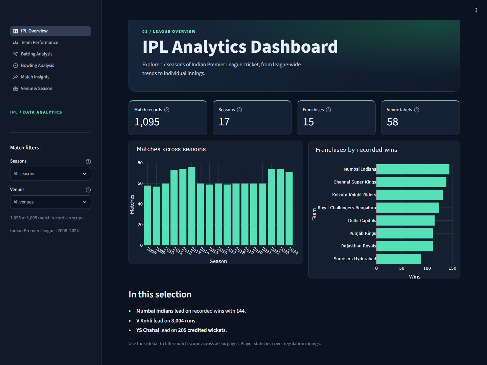
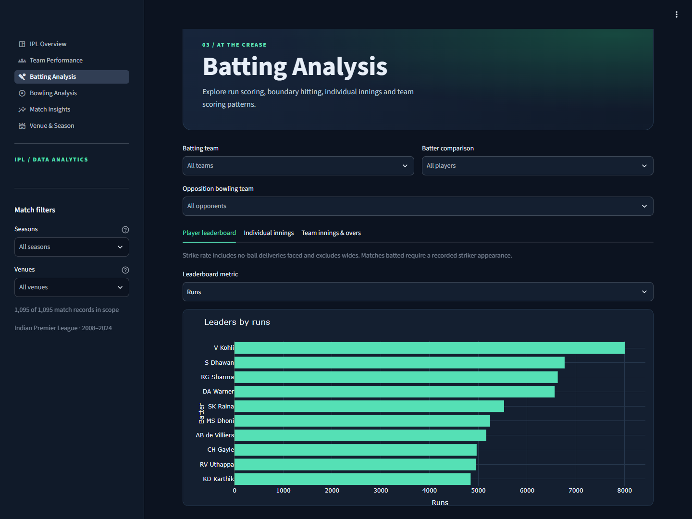
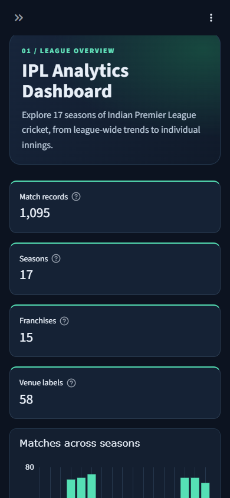

# IPL Analytics Dashboard

An interactive analysis of Indian Premier League cricket from 2008 to 2024. Python and Pandas handle data preparation and calculations, Plotly renders the charts, and Streamlit provides the dashboard, filters, comparisons and CSV exports. The [original analysis notebook](notebooks/ipl-analysis.ipynb) contains the exploratory work and Matplotlib and Seaborn visualizations.

**[Open the live IPL Analytics Dashboard](https://ipl-analytics-khalil.streamlit.app/)**



## Questions explored

- Which franchises accumulated the most wins, and how did their win rates and scoring change by season?
- Who leads in batting, boundary hitting, wicket-taking and run control under comparable qualification rules?
- How often did toss winners win the match, and how did that rate vary with the decision to bat or field?
- Which grounds hosted the most matches, and how did results and scoring differ by season and venue?

## Data and preparation

| Source file | Grain | Coverage |
| --- | --- | --- |
| [matches.csv](data/matches.csv) | One row per match ID | 1,095 records, including five without a recorded winner |
| [deliveries.csv](data/deliveries.csv) | One row per recorded delivery | 260,920 rows, including 161 Super Over rows |

The dashboard uses the two CSVs supplied with this repository. Their upstream download and license are undocumented in the supplied files.

- Validate unique match IDs and delivery keys `(match_id, inning, over, ball)`, then verify that each delivery references an existing match. The supplied files have no duplicate keys or orphan delivery IDs. Aggregate deliveries before joining match metadata and use validated many-to-one joins.
- Preserve the four franchise mappings from the notebook and apply them to all team fields, including the toss winner. Parse match dates and use the first match year of each edition for display, so `2007/08`, `2009/10` and `2020/21` appear as 2008, 2010 and 2020.
- Standardize Bangalore to Bengaluru. Keep 51 blank cities in an **Unknown city** bucket, retain the 58 source venue labels, and preserve missing winners and margins. A blank method indicates that no D/L flag is recorded.
- Use innings 1 and 2 for player statistics. Team scoring follows the notebook's additional requirement of a recorded winner and no D/L flag. Display Super Over and D/L match records separately.

## Findings and reconciliation

- Mumbai Indians recorded **144 wins in 261 matches**. Eden Gardens hosted **77 matches** under that exact venue label. Both agree with the notebook.
- The toss winner won **554 of 1,090 decided matches (50.83%)**, up from **421 (38.62%)** in the main notebook after applying the franchise mappings to toss winners. The rates were **45.38%** after choosing to bat (177/390) and **53.86%** after choosing to field (377/700). These observed rates do not establish a causal effect of the toss or the decision.
- Virat Kohli led with **8,004 regulation runs**. The notebook's **8,014** included 10 Super Over runs. Chris Gayle's regulation total is **357 sixes**, down from 359, and his **175** remains the highest individual innings.
- Yuzvendra Chahal led with **205 bowler-credited wickets**, matching the main notebook for that player. The practice notebook's **213** counted every dismissal against the bowler. Across the dataset, the main notebook's exclusion list also credited three retired-out dismissals. The dashboard uses an explicit list of credited dismissal types.
- Bowling concessions include batter runs, wides and no-ball extras. Byes, leg-byes and standalone penalty extras stay in the team total. For example, the notebook charged a seven-run penalty to SL Malinga in match 729309. Balls bowled and dot-ball percentages use legal deliveries, excluding wides and no-balls. The dot-ball rate leaderboard applies the notebook's stated minimum of more than 100 deliveries, which its code omitted.
- The team-scoring sample contains **2,138 innings**. The high of **287** and low of **49** agree with the notebook. The death-over band begins at over 16. The notebook's zero-based `over >= 16` started at over 17. Phase averages include innings that reached the displayed over band, including partial phases.

Cricket rules and tie-break procedure are documented in the [MCC Laws of Cricket](https://lawsofcricket.lords.org/) and [IPL 2024 playing conditions](https://documents.iplt20.com/bcci/documents/1710742982442_TATA%20IPL%202024%20Match%20Playing%20Conditions%20.pdf).

## Explore the dashboard

| Page | Analysis |
| --- | --- |
| IPL Overview | Match, season, franchise and venue KPIs, season volume and leaders |
| Team Performance | Wins, win rates, toss conversion, season comparisons and team scoring |
| Batting Analysis | Runs, boundaries, strike rates, consistency, player comparisons, innings and over-by-over scoring |
| Bowling Analysis | Wickets, economy, average, strike rate, dots, comparisons and innings figures |
| Match Insights | Toss, chasing, win margins, match stages, awards, Super Overs and D/L |
| Venue & Season | Ground and city usage, match shares, scoring trends and franchise records by venue |

The sidebar applies season and venue filters across all pages. Player views support role-specific team and player filters, with an opposition filter for batting. Use a table's column header to sort or download the current filtered table as CSV.



<details>
<summary>Mobile overview</summary>



</details>

Batting strike-rate rankings require **500 balls faced**, counting no-ball deliveries faced and excluding wides. Bowling economy, average and strike-rate rankings require **500 legal balls**. Qualifications apply within the current selection. Selected player trend tables also show individual season samples.

## Run locally

Use Python 3.13, the version used for verification. From the repository root on Windows PowerShell:

```powershell
python -m venv .venv
.\.venv\Scripts\python -m pip install -r requirements.txt
.\.venv\Scripts\python -m streamlit run app.py
```

Open [the local dashboard](http://localhost:8501). On macOS or Linux, use `.venv/bin/python` in place of the Windows interpreter path.

Run the reconciliation checks with `python -m unittest discover -s tests -v` using the project environment.

The app caches CSV validation and innings-level aggregation. One local measurement took 1.75 seconds to prepare 260,920 delivery records and 0.17 seconds to calculate the full-scope batting, bowling and team-scoring summaries.

## Deploy to Streamlit Community Cloud

1. Push the repository to GitHub with both CSVs, `app.py`, `ipl_dashboard/`, `.streamlit/config.toml` and `requirements.txt`.
2. Open [Streamlit Community Cloud](https://share.streamlit.io/) and create an app from the GitHub repository and branch.
3. Set the main file path to `app.py`. In Advanced settings, select Python 3.13 and deploy. The app reads its bundled CSVs and needs no secrets. [Streamlit deployment guide](https://docs.streamlit.io/deploy/streamlit-community-cloud/deploy-your-app/deploy)

## Project layout

| Path | Purpose |
| --- | --- |
| `app.py` | Navigation, shared filters and cached data |
| `ipl_dashboard/data.py` | CSV validation, standardization and innings-level facts |
| `ipl_dashboard/analysis.py` | Match, franchise and player calculations |
| `ipl_dashboard/pages.py` | Six dashboard views |
| `ipl_dashboard/ui.py` and `style.css` | Plotly charts, data tables and visual design |
| `data/`, `notebooks/` | Source data and exploratory analysis |
| `images/`, `tests/` | Dashboard screenshots and reconciliation checks |

## Limitations and future work

- Venue variants are source labels. A venue reference table could consolidate confirmed ground aliases while preserving historical names. The city figures group only the known Bangalore/Bengaluru spelling variant.
- A match batted requires a recorded striker appearance. Playing XIs and players who never faced a delivery are outside the scope. Boundary counts use the runs field as a proxy because the dataset lacks a separate boundary flag.
- The source stores one extras type per row, which limits reconstruction of deliveries with multiple extras. Recorded D/L flags describe this dataset's coverage of adjusted matches. Fixed over bands cannot reconstruct shortened powerplays.
- Win percentage uses all match appearances, including no-results. Toss conversion uses matches with a recorded winner. Season and venue slices can have small samples, and rankings should be read alongside the displayed counts.
